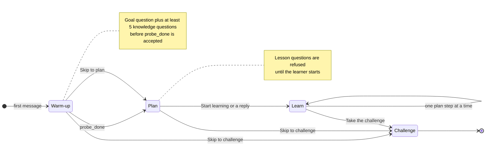
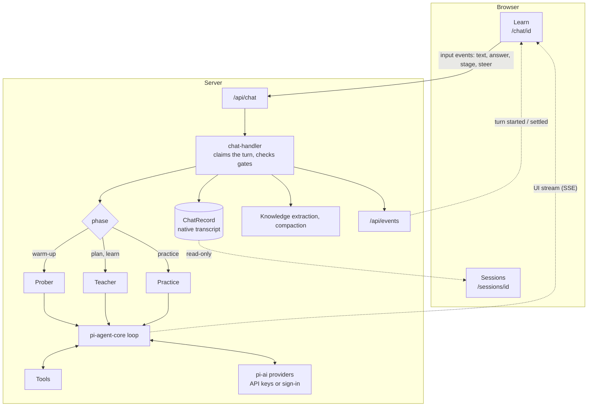
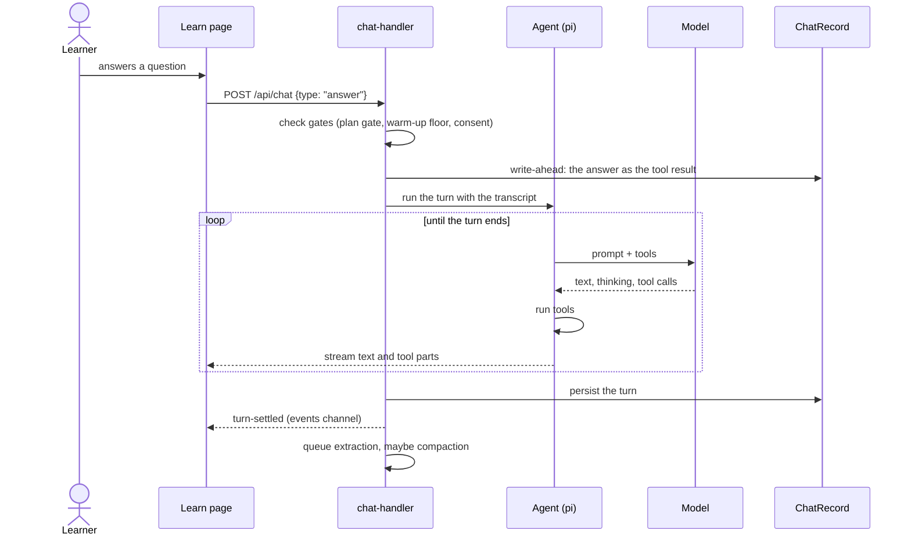
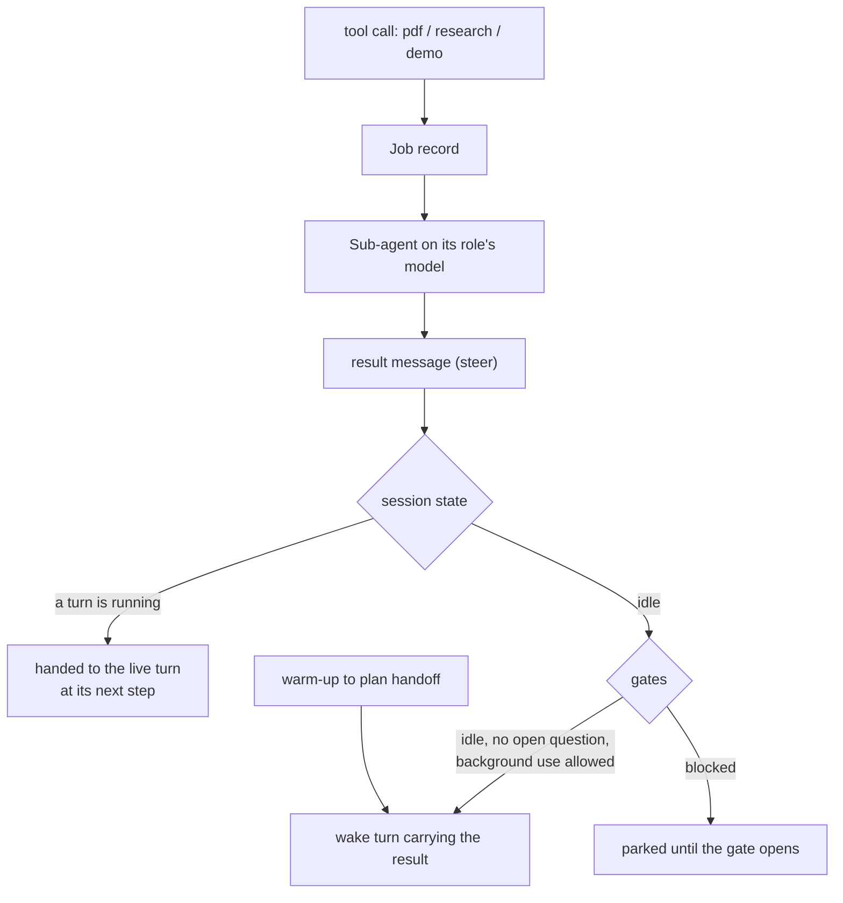

# neuroplast

A tutor that finds where your understanding runs out, plans a path from
there, teaches it one step at a time, and tests it with a scored challenge.
Built with Next.js, React and TypeScript. The agents run on
[pi](https://github.com/earendil-works) (`pi-agent-core`, `pi-ai`), so any
provider pi supports can drive a lesson.

## What's in the app

| Place | What it is |
| --- | --- |
| **Learn** | The learning space. A session starts with a warm-up, builds a plan, then teaches. Once the lesson starts, Learn shows only the lesson: the plan's steps and the questions. |
| **Sessions** | Every session as a record: each stage in its own section, plus the session's challenge. Read-only, with **Continue learning** back to Learn. |
| **Challenges** | Ten scored questions. Missed skills turn into training (recall, discrimination, application, delayed recall), then a retake. The first chapter is linear equations. |
| **Knowledge** | Every topic as a skill tree: Learn sessions by plan step, challenges by skill. **Learn** and **Take the challenge** buttons on each topic. |
| **Practice** | A problem loop on one skill: you work in a thinking field, the tutor reads it and moves on. |
| **Settings** | Model slots, provider API keys, Grok sign-in, appearance and prompts. |

## A Learn session



1. **Warm-up.** The prober asks what the learner is studying for, invites a
   syllabus or notes (PDF, text, Markdown), and asks questions until it finds
   the edge of what they know. It ends with an assessment and a short topic
   title for the session.
2. **Plan.** The teacher writes a plan of 5–15 steps, shown as an outline and
   as a skill tree in Knowledge. It waits for **Start learning**.
3. **Learn.** Teaching runs step by step. Every lesson question names its plan
   step, so progress shows in the outline and in Knowledge.
4. **Challenge.** One scored challenge per session, built from its plan.

While a section waits on the tutor it shows a loading screen. After 20 idle
seconds it offers **Retry**. The full rules, buttons and gates live in
[docs/session-flow.md](docs/session-flow.md). Read it before changing how a
session moves between stages.

## The harness

The harness is the server side of a session: it turns learner input into
agent turns, runs tools, streams the result, and keeps the transcript.



**Agents.** One session, three instruction sets, chosen by the phase derived
from the transcript:

| Agent | Runs | Tools |
| --- | --- | --- |
| Prober | the warm-up | `probe` (or `recall`), `ask_user_question`, `probe_done`, file tools, `pdf`, `research` |
| Teacher | plan and lesson | `quiz` (or `explain`), `ask_user_question`, `plan_init`, file tools, `pdf`, `research`, `demo` |
| Practice | practice sessions | `problem`, `conclude` |

File tools (`read`, `ls`, `find`, `grep`) read only the materials folder and
refuse PDFs and binaries; PDFs go to the `pdf` job. Question tools end the
turn: the learner's answer comes back as the call's result.

**One turn.**



**Background jobs and the wake pipeline.** `pdf`, `research` and `demo`
return at once, so the lesson goes on. Each runs as its own sub-agent on its
role's model slot, falling back to the session's model when that slot has no
key. The result comes back as a message the tutor reacts to.



The warm-up → plan handoff rides the same pipeline but is never treated as
background use, since it is the lesson's own next step.

**Model slots.** Settings has three slots: **strong** (prober, teacher),
**cheap** (research, demos, extraction) and **vision** (PDF reading). Each
role can be overridden.

## Run locally

Use Node.js 24 or newer.

```sh
npm install
cp .env.example .env.local
npm run dev
```

Open http://127.0.0.1:3000, then add a provider key and pick models in
Settings, or sign in to Grok under Connections. Challenges and scoring run without a model.

Grok sign-in uses pi's own SuperGrok / X Premium login. Set
`XAI_OAUTH_CLIENT_ID` only to use your own xAI client registration instead.

```sh
npm test           # node test runner, tests/*.test.mjs
npm run typecheck
npm run lint
npm run build
```

If your environment cannot run Turbopack's compiler subprocess, use
`npm run build -- --webpack`.

## Storage

One private workspace per server process.

| What | Where |
| --- | --- |
| Sessions, jobs, challenges, knowledge graph, settings, API keys | `.neuroplast/workspace/` (files) |
| Browser identities, encrypted subscription credentials | `.neuroplast/neuroplast.sqlite` |
| Uploaded and readable study files | `.neuroplast/materials/` (`NEUROPLAST_MATERIALS_DIR`) |

`NEUROPLAST_DATA_DIR` relocates the workspace. A session's record is its
native agent transcript; everything the UI shows (stages, questions, plan
progress) is derived from it.

## Production

Requires HTTPS, persistent writable storage, `NEUROPLAST_WORKSPACE_PASSWORD`,
`NEUROPLAST_ORIGIN` and a stable `NEUROPLAST_CREDENTIAL_KEY`
(`openssl rand -base64 32`). Deploy on a persistent Node server. Interactive
demos are tested in a headless Chrome found through `CHROME_PATH`.

## More

- [Session flow](docs/session-flow.md): stages, gates, buttons, background work
- [Architecture](docs/architecture.md): contexts and boundaries
- [Challenge direction](docs/challenge-practice-direction.md)
- [Grok connection design](docs/subscription-sign-in-design.md)
- [LearnHarness integration](docs/learnharness-integration.md)

## License and credits

Neuroplast is licensed under the
[GNU Affero General Public License, version 3 only](LICENSE)
(AGPL-3.0-only). If you run a modified copy as a service, you must offer its
users the source; the sidebar's **Source code** link does this, and
`NEXT_PUBLIC_NEUROPLAST_SOURCE_URL` points it at your own repository.

Neuroplast is a modified version of
[LearnHarness](https://github.com/amosblomqvist/learnharness) by Amos
Blomqvist (AGPL-3.0-only), ported from commit `0795ef1`. Its learning engine,
agents, knowledge graph and background jobs started there;
[docs/learnharness-integration.md](docs/learnharness-integration.md) maps
where each part lives now.

The agents run on [pi](https://github.com/earendil-works/pi) by Mario
Zechner (MIT), and the compaction cutoff is ported from pi's coding agent.
UI components come from EasyUI by Suraj Maurya (MIT). The full notices are in
[NOTICE](NOTICE), [docs/licenses](docs/licenses) and `src/ui/easyui/LICENSE`.
