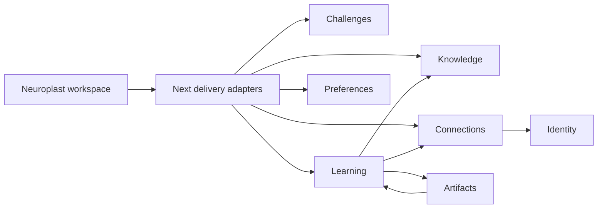

# Neuroplast architecture

Neuroplast is one Next.js application organized as a modular monolith. Business
capabilities determine the structure. A new feature belongs to the context that
owns its rules and data, rather than a global components, services, or utils folder.

The main learner journey is now a versioned, scored challenge followed by
targeted recall, discrimination, application, and a parallel retake. The first
chapter covers linear equations. Existing LearnHarness tutor sessions remain
readable in Session history while the challenge loop replaces their entry point.

The existing Neuroplast interface is the delivery surface. Reusing the learning
runtime does not introduce a second application shell, session store, or composer
workflow. Shared EasyUI buttons and form controls provide the same design across
new pages and the richer session tools.

## Context ownership

| Context | Owns | Collaborates with |
| --- | --- | --- |
| Challenges | Topic and skill blueprint, answer-key generation, scored attempts, targeted training, retakes | Learning for legacy history; Connections only for future optional explanations |
| Learning | Session aggregate, native conversation history, lesson plans, probe/teach transitions, questions, adaptive practice, turn execution, steering, compaction | Connections for model execution; Artifacts for jobs; Knowledge for learning context and extraction; Preferences for effective settings |
| Knowledge | Knowledge nodes, reasoning chains, evidence, source provenance, extraction coverage, graph positions and projections | Learning session IDs and history; Connections for extraction models |
| Connections | Provider credentials, subscription lifecycle and consent, model catalog, provider adapters and stream construction | Identity for browser ownership; Preferences for selected models |
| Artifacts | Job aggregate, lifecycle, research briefs, interactive demos, SVGs, PDFs and artifact renderers | Learning for result delivery; Connections for worker models |
| Preferences | Versioned workspace settings, model slots and overrides, appearance, keyboard settings, prompt overrides | Connections model identifiers and Learning settings contracts |
| Identity | Opaque browser session identity and expiration | Connections credential ownership |

Learning's `ChatRecord` is the canonical session aggregate. The server persists
native agent history, and the UI derives questions, plans, phases, and messages
from it. Knowledge's ledgers retain provenance separately from the session;
deleting a session explicitly chooses whether its graph traces should remain.
Artifacts have their own durable job records and return results into Learning.
Connections have a revisioned lifecycle independent of any one lesson.

## Source structure

```text
app/                           Next.js page and HTTP delivery adapters
src/domains/
  challenges/
  learning/
  knowledge/
  connections/
  artifacts/
  preferences/
  identity/
    domain/                    Context-owned models, rules and contracts
    application/               Use cases and orchestration where applicable
    infrastructure/            Persistence, model, filesystem and network adapters
    presentation/              Context-specific React views and interaction logic
src/platform/
  presentation/                One workspace shell and app-wide providers
  server/                      Request context, configuration and store composition
  database/                    SQLite lifecycle
src/shared/
  kernel/                      Small domain-neutral helpers
  lib/                         Generic UI utilities and formatting
  ui/                          EasyUI components, compatibility primitives, theme
```

Not every context needs every folder. Internal layer arrangements may remain
pragmatic; context ownership and explicit contracts are the application-wide rule.
The `domain/ports.ts` files belong to their respective contexts. Learning no
longer defines storage interfaces for Graph, Jobs, Settings, and Credentials.

## Runtime flows



Starting a boss challenge creates a server-owned attempt through
`/api/challenges`. The answer key stays on the server; responses are persisted
one question at a time. Submission produces an overall score, a recall and
application split, and results for each skill. Missed skills seed training
tasks in four stages: recall, discrimination, application, and delayed recall.
A retake generates a new form with the same skill blueprint and links its
score to the previous attempt. Challenge and training records live under
`NEUROPLAST_DATA_DIR/challenges` (or `.neuroplast/workspace/challenges`).
Boss and training problems can open a lazy-loaded Excalidraw scratchpad. Each
problem's drawing is stored in browser local storage under its attempt and
question IDs; drawings are private to that browser and are not part of grading.
The Knowledge tree projects the same challenge records into topic and skill
states. A skill's current status follows its latest scored attempt; completed
training cycles and practice counts accumulate across attempts. The former
notes graph remains accessible at `/knowledge/legacy`.

Legacy tutor sessions create a server session through `/api/chats`. The session view
then uses `/api/chat` and the existing turn/stream protocol, including tool calls,
questions, steering, plans, background results, and compaction. The former simple
`/api/learning/turn` implementation and browser-only session repository are removed.
The opening draft moves into the session within the browser tab; attached notes
are sent in the turn's request body rather than a potentially oversized URL.

The sidebar and Sessions page fetch the same `/api/chats` records. Server events
announce changes and clients fetch the current projection. Knowledge imports and
session extraction use the same Knowledge pipeline; practice can carry selected
knowledge nodes into a Learning session.

Grok authorization remains in Connections. API handlers establish the browser's
request context; provider adapters resolve its encrypted credential for each
dispatch. A connected account contributes model availability to the same catalog
used by lessons and model pickers. Background subscription use requires consent.
Provider API keys are stored with the private workspace and resolved for each
dispatch. The Connections screen uses the same key and model APIs as Preferences.

## Boundaries when adding features

Add new learning rules to Learning, graph/evidence rules to Knowledge, and provider
protocols to Connections. A context exports explicit contracts or operations;
another context should not reach directly into its storage implementation. Wire
concrete store adapters in `platform/server/workspace-stores.ts`. App-wide
presentation composes context views without taking ownership of their rules.

Domain models remain independent of Next.js, React, persistence adapters, and
platform composition; ESLint enforces this. Deterministic `node:crypto` hashing is
allowed for existing knowledge identifiers. Application and adapter internals can
retain their working structure while context interfaces evolve.

## Current deployment boundary

The file-backed learning domains currently form one private workspace per server.
The production proxy gates all workspace pages and APIs with a workspace password
and checks the origin of mutations. Browser-owned Grok credentials do not imply
separate user-owned lesson databases. A public multi-user product will need an
explicit Workspace ownership model and tenant-scoped persistence adapters first.
